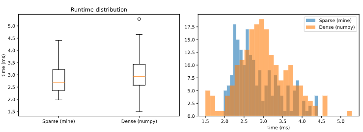

# 1
## a

$$
A= \begin{bmatrix}
3 & -1 \\
-1.5 & 7
\end{bmatrix}
, b=\begin{bmatrix}
7.5 \\
7
\end{bmatrix}
$$

```{python}
#| echo: false
#| output: false

import numpy as np

A=[[3,-1],[-1.5,7]]
b=[7.5,7]

print("Using np.linalg.solve:", end = "\n\t")
print(np.linalg.solve(A,b))

print("Using np.linalg.inv:", end = "\n\t")
print(np.matvec(np.linalg.inv(A),b))

```

We can use the `np.linalg.inv` function to find $x$ because $Ax=b \rightarrow A^{-1}A x = A^{-1}b \rightarrow x= A^{-1}b$

Both `np.linalg.inv` and the `np.linalg.solve` approaches ended with the same result as below:

$$
x = \begin{bmatrix}
3.05128205  \\
1.65384615
\end{bmatrix}
$$

According to the numpy documentation, `np.linalg.solve` uses the LAPACK routine allowing us to compute the optimal $x^*$ without computing $A^{-1}$. This is important because we've discussed in class that inverting matrices can be ill conditioned depending on $A$ and should avoid doing that when possible. 

So the advantages of `np.linalg.solve` is that it avoids computing $A^{-1}$ and is generally considered to be faster than finding the inverse then multiplying (it is still $O(n^3)$ but slightly smaller coefficient). But then that leads to the disadvantage of not finding $A^{-1}$ thus for finding $x$ on $d$ distinct values for $b$ would be $O(dn^3)$

The advantage of `np.linalg.inv` or using the inverse in general is that if the inverse is easy to compute or we already have it then we can quickly find the solution with matrix vector multiplication in $O(n^2)$ time. The disadvantage is like mentioned before that computing the inverse could be ill conditioned and as well take $O(n^3)$ with a higher coefficient than `np.linalg.solve` so the inverse method should be used when we have multiple $b$ that we are using or the inverse is easy to find.

## b

$$
A= \begin{bmatrix}
3 & -1 \\
-1.5 & 7 \\
0.75 & 3 
\end{bmatrix}
, b=\begin{bmatrix}
7.5 \\
7 \\
7.25
\end{bmatrix}
$$


```{python}
#| echo: false
#| output: false

import numpy as np

A=[[3,-1],[-1.5,7],[0.75,3]]
b=[7.5,7,7.25]

print("Using np.linalg.lstsq:", end = "\n\t")
print(np.linalg.lstsq(A,b))

```

The unique thing about this system is that using `np.linalg.lstsq` to solve it gets the same $x$ as in **1.a**:

$$
x = \begin{bmatrix}
3.05128205  \\
1.65384615
\end{bmatrix}
$$

The sum of the resuiduals squared is $2.63976342\times 10^{-31}$ so basically the residuals are near $0$ so this means it is a good fit. In the real world however, overdetermined systems are likely to have much much poorer fits and no solution with near $0$ residuals like this one. The purpose of the `np.linalg.lstsq` is to find the solution that minimizes the squared sum of the residuals.

## c

$$
A= \begin{bmatrix}
3 & -1 & -2\\
-1.5 & 7 & 1
\end{bmatrix}
, b=\begin{bmatrix}
3.5 \\
9
\end{bmatrix}
$$

```{python}
#| echo: false
#| output: false

import numpy as np

A=[[3,-1,-2],[-1.5,7,1]]
b=[3.5,9]
A_t=np.transpose(A)

print("Using np.linalg.solve:", end = "\n\t")
x = (np.linalg.solve(np.matmul(A_t,A), np.matvec(A_t,b)))

print(x)

print("Does the solution hold? Ax-b=", end="\t")
print(np.matvec(A,x)-b)


print("Euclidean Norm:", end="\n\t")
print(np.linalg.norm(x))

```

Using `np.linalg.solve` on the system $A^TA x = A^T b$ gets the following $x$:

$$
x = \begin{bmatrix}
2.68554131 \\ 
1.65384615 \\
1.45138889
\end{bmatrix}
$$

We can check if the solution holds with the following computation:

$$
Ax -b = \begin{bmatrix}
-1.77635684\times 10^{-15} \\
0
\end{bmatrix}
$$

>> I am attributing the nonzero residual to machine precision and funny rounding issues with floating point representation in python. 

The euclidean norm of $x$ is $3.471868220138227$


## d

```{python}
#| echo: false
#| output: false

import numpy as np

A=[[3,-1,-2],[-1.5,7,1]]
b=[3.5,9]
A_t=np.transpose(A)

print("Using np.linalg.inv:", end = "\n\t")

x=np.matvec(np.matmul(A_t,np.linalg.inv(np.matmul(A,A_t))),b)

print(x)

print("Does the solution hold? Ax-b=", end="\t")
print(np.matvec(A,x)-b)

print("Euclidean Norm:", end="\n\t")
print(np.linalg.norm(x))

```


Using `np.linalg.inv` to find $x = A^T(AA^T)^{-1} b$ gets the following $x$:

$$
x = \begin{bmatrix}
1.18934911 \\ 
1.65384615 \\
-0.79289941
\end{bmatrix}
$$

We can check if the solution holds with the following computation:

$$
Ax -b = \begin{bmatrix}
0 \\
0
\end{bmatrix}
$$

The euclidean norm of $x$ is $2.1859661213013957$ which is less than our solution in **1.c**. Now we expect to see this because our solution here in **1.d** is the minimum-norm solution meaning this $x$ is the solution with the smallest euclidean norm.


# 2
## a
We are trying to solve the system $A\vec\beta = \vec y$ with the below definitions:

$$
A = \begin{bmatrix}
1 & x_1 \\
1 & x_2 \\
\dots & \dots \\
1 & x_n
\end{bmatrix}
, \vec\beta = \begin{bmatrix}
\beta_0 \\
\beta_1 
\end{bmatrix}
, \vec y= \begin{bmatrix}
y_1 \\
y_2 \\
\dots \\
y_n
\end{bmatrix}
$$

Now since this is clearly overdetermined, by the problem definition we are instead trying to adhere to the below objective function:

$$
\min_{\vec\beta}||A\vec\beta-\vec y ||_2^2 + \alpha||\vec \beta ||_2^2
$$

Since this is a minimization objective function and looking at the $2$-norm, we essentially set the function to the $\vec 0$ vector. We also need to make esure all the dimensions line up so we get the following:

$$
\vec 0 = A^TA\vec\beta-A^T\vec y + \alpha I\vec \beta
$$
$$
A^TA\vec\beta+ \alpha I\vec \beta = A^T y
$$
$$
(A^TA+ \alpha I)\vec\beta =  A^T y
$$

Setting $\alpha=0$ and some rearranging:


$$
A^TA\vec\beta =  A^T y
$$

$$
\vec\beta = (A^TA)^{-1} A^T y
$$

Then we look at $A^TA$ and its inverse ($n\overline x$ is just the sum over all entries of $\vec x$):

$$
A^T A = n\begin{bmatrix}
1 & \overline x \\
\overline x & \overline{x^2}
\end{bmatrix} 
\rightarrow (A^T A)^-1 = \frac{1}{n(\overline{x^2}-\overline x^2)} \begin{bmatrix}
\overline{x^2} & -\overline x \\
- \overline x & 1
\end{bmatrix}
$$

Then looking at $A^T \vec y$:

$$
A^T \vec y = n \begin{bmatrix}
\overline y \\
\overline {xy}
\end{bmatrix}
$$

Thus we get $\beta$ by doing the good ol' classic row column matrix multiplication. First row is for $\beta_0$ and second for $beta_1$ thus:

$$
\beta_0 = \frac{\overline{x^2}\overline y -\bar x \overline{xy}}{\overline{x^2}-\overline x^2} \\
, \beta_1 =\frac{\overline{xy} -\bar x \bar y}{\overline{x^2}-\overline x^2} 
$$

Which is then commonly rewritten as:

$$
\beta_1 =\frac{\overline{xy} -\bar x \bar y}{\overline{x^2}-\overline x^2} 
,\beta_0 = \bar y - \beta_1 \bar x
$$

Thus the intuition behind $\beta_0$ is simply making the line pass through the point $(\bar x, \bar y)$ because that is the middle of the data

For $\beta_1$, the intuition is the covariance between $x$ and $y$ divided by the variance of $x$. Dividing by $\operatorname{Var}(x)$ normalizes how much $x$ and $y$ move together by how much $x$ moves on its own, giving the expected change in $\hat y$ per unit change in $x$.


## b
If $\bar x =0$ then we get the following:

$$
\beta_1 =\frac{\overline{xy} -0 \bar y}{\overline{x^2}-0^2} 
,\beta_0 = \bar y - \beta_1 0
$$


$$
\beta_1 =\frac{\overline{xy}}{\overline{x^2}} 
,\beta_0 = \bar y 
$$

Now adding back in the regularization:

$$
(A^TA+ \alpha I)\vec\beta =  A^T y, \> A^T A + \alpha I = \begin{bmatrix}
n + \alpha & 0 \\
0 & n \overline {x^2} + \alpha
\end{bmatrix}
$$

Inverting this matrix:

$$
(A^T A + \alpha I)^{-1} = \begin{bmatrix}
\frac 1{n+\alpha} & 0 \\
0 & \frac 1{n\overline{x^2}+\alpha}
\end{bmatrix}
$$

Therefore $\beta$ is as follows from $(A^T A +\alpha I)^{-1} A^T y$:

$$
\beta_0 = \frac{n \bar y}{n+\alpha}, \beta_1 =\frac{n \overline{xy}}{n\overline{x^2}+\alpha}
$$

Thus the effect regularization has on our $\beta$'s is that as $\alpha$ increases we shrink the $\beta$'s to $0$. Now there are many purposes of $\alpha$, such as avoiding overfitting, ill conditioned $A^T A$ (allowing the matrix to be inverted) or noisy data. Specifically, the $\beta$'s are likely to be off in under sampled and noisy data so regularization could help with model fit. 

## c

We can start our expirement by creating a data set that is populated from $mx+b + \epsilon$ where $\epsilon$ is some randomly sampled noise. Thus the true coefficients we are looking for are $\beta_0=b,\beta_1=m$ 

```{python}
#| echo: false

import numpy as np
import matplotlib.pyplot as plt

rng = np.random.default_rng(323)
beta_true = np.array([2.0, 3.0])   # TODO: pick your true coefficients

def make_instance(n, x_spread, noise_sd):
    x = rng.uniform(-x_spread, x_spread, n)
    x = x - x.mean()                      # center x, as in 2(b)
    y = beta_true[0] + beta_true[1] * x + rng.normal(0, noise_sd, n)
    return x, y

def ridge(x, y, alpha):
    A = np.column_stack([np.ones_like(x), x])
    return np.linalg.solve(A.T @ A + alpha * np.eye(2), A.T @ y)

instances = {
    "Instance 1: n=1,000, wide x, low noise": make_instance(1000, 10.0, 1),   # TODO tune
    "Instance 2: n=10, narrow x, high noise": make_instance(10, 1, 5.0),     # TODO tune
}

alphas = np.logspace(-3, 3, 50)

fig, axes = plt.subplots(1, 2, figsize=(11, 4))
for ax, (name, (x, y)) in zip(axes, instances.items()):
    betas = np.array([ridge(x, y, a) for a in alphas])
    ax.semilogx(alphas, betas[:, 0], label=r"$\beta_0$")
    ax.semilogx(alphas, betas[:, 1], label=r"$\beta_1$")
    ax.axhline(beta_true[0], ls="--", c="C0", alpha=.5)
    ax.axhline(beta_true[1], ls="--", c="C1", alpha=.5)
    ax.set_title(name, fontsize=9)
    ax.set_xlabel(r"$\alpha$")
    ax.legend()
plt.tight_layout()
plt.show()

```

Here we can clearly see that as $\alpha$ increases the $\beta$'s go to $0$. Additionally, we see that in well sampled non-noisy data we get that the OLS is able to almost perfectly recover the original $m,b$ as our $\beta$'s. On the other hand, we see that in ill sample and noisy data we see that originary OLS (when $\alpha=0$) does not do a good job at recovering the $m,b$ but as we increase $\alpha$ we start to approach the true $m,b$ unless of course we increase $\alpha$ too much and we go to $0$ again.


# 3
## a
### i
Adding two sparse matrices benefits from sparsity because we only iterate over the number of nonzeros.

$$ 
A+B=C
$$

### ii
If it is in row major format we can basically do a merge sort operation to combine the matrices. We keep a couple pointers in each matrix and iterate through the values $V_A,V_B$ checking their corresponding indices in $R_A,R_B,C_A,C_B$ and add them to the resulting $V_C,R_C,C_C$ based on the values that come first in row, then first in column (like alphabetical ordering but first letter is the row index and second letter is the column index). In the case of $R_A[i]=R_B[i]$ and $C_A[j]=C_B[j]$ then we store $V_A[j]+V_B[j]$ into $V_C$

This would be $O(|R|+nnz(A)+nnz(B))$

### iii
The result is probably sparse because $nnz(A+B)\leq nnz(A) + nnz(B)$ thus were at most as dense as the combined density of the matrices. 

## b
### i
Benefits from sparsity because $a_{ij}b_{ij}$ product only needs to be calculated when both $a_{ij}b_{ij}$ are non zero and can be skipped otherwise.

### ii
I would convert $B$ to column major format and keep $A$ in row major format. Then for each $C_A$ iterate through $R_B$ keeping track that im checking the the right row of $A$ and columb of $B$ through $R_A,C_B$. Then when $C_A=R_B$ I can add the corresponding multiple if $V_A,V_B$ into the resulting $V_{AB}$

So runtime would be $O(|R| + nnz(A)\times nnz(B)$

### iii
Not guarenteed to stay sparse. Easy counterexample is the first column of $A$ is all $1$'s and the first row of $B$ is all $1$'s. Now despite only having $2n$ non zeros (1-1/n is the proportion of $0$'s we have) we would end up with $AB=$ a full $n\times n$ matrix of $1$'s.

## c
### i
Benefits from sparsity because we can do the multiplication where we iterate through the rows and number of non zeros as opposed to $O(2n^2)$

### ii
Essentially compute $B\vec x$ first then multiply the resulting vector by $A$. Suppose $\vec y = B\vec x$, then define $j$ s.t. $R_B[j]\leq i < R_B[j+1]$ then $y[j]+=V_B[i]\times x[C_B[i]]$ assuming $y$ is initialized with $0$'s. Then repeat idea for computing $A\vec y$

This results in a total runtime of $O(n + nnz(A)+nnz(B))$

### iii
While the final vector $\vec w = AB\vec x$ is potentially non sparse, we never computed $AB$ so we remained sparse the whole time and only had at most $O(n+nnz(A))$ or $O(n+nnz(B)$ in memory at a time and never had a full $O(n^2)$ part. 

## d
### i
Similar benefit as **3.c** because we can just do repeated sparse matrix vector multiplications. 

### ii
Since $w_i$ is a scalar we can do some rewrites:

$$
\sum_{i=0}^d w_i A^i \vec x = \sum_{i=0}^d  A^i w_i \vec x = w_0\vec x + A(w_1 \vec x + A(\dots + A(w_d \vec x)))
$$

So similar algorithm as in **c**, we do sparse matrix vector multiplication and keep a running vector going. So we never comput $A^d$ which is likely dense. Instead we perform $d+1$ vector scalar multiplications and $d+1$ sparse vector multiplications so runtime is $O(d(n+nnz(A)))$

### iii
The only things ever in memory are $n$ dimensional vectors and the sparse storage of $A$ so we never have a non sparse thing stored in memory but the resulting vector is very likely to be non sparse.


# 4
## a
```{python}
# Works Since we are Sorted By 2nd Value and Both Directions Are in the CSV

R=[]
C=[]
V=[]
prev = -1
count = 0

Dense=np.zeros((2708,2708))

with open("data/graph.csv") as f:
  for line in f:
    line = line.strip()
    if not line:
      continue
    u, v = line.split(",")[:2]
    if v != prev:
      prev = v
      R.append(count)
    C.append(int(u))
    V.append(1)
    count += 1
    Dense[int(u),int(v)] = 1
    Dense[int(v),int(u)] = 1
  

R.append(len(V))

print("nodes:", len(R)-1, " stored nonzeros:", len(V))
```


## b
Since we have an unweighted graph, suppose we are looking at $Ax=y$, the resulting $y$ can be defined as below: $$y_i=A_{i,1}x_1+A_{i,2}x_2+\dots +A_{i,n}x_n$$

Thus since values of $A_{i,j}$ are $1$ iff there is a connection between $i$ and $j$, then $y_i$ is the sum of the $x_j$ values for $j$ that are adjacent to $i$. In short each $y_i$ corresponds to the sum of the values of the neighbours of $i$.

An example of this could be something like criminal justice where our $x_i=v$ where $v$ is the value assigned to person $i$ and $A_{i,j}=1$ if there is contact between person $i$ and $j$. Thus the values of $y$ resulting from $Ax$ would be a set of $n$ scores for each person based on their contact to other people. If our $x_i=v$ values are higher for key individuals then $y_i$ is high if a person is in contact with a bunch of high value / key individuals.  


## c
```{python}

def multiply(R,C,V, x):
  y = np.zeros(len(R)-1)
  temp = 0
  row = 0
  for i in range(len(C)):
    temp += x[C[i]]
    if i+1 == R[row+1]:
      y[row] = temp
      temp = 0
      row += 1

  return y


def multiplys(R,C,V, x):
  y = np.zeros(len(R)-1)
  row = -1
  for i in range(len(C)):
    if i >= R[row+1]:
      row += 1
    y[row] += C[i]

  return y

def dense(D, x):
  return D @ x

rng = np.random.default_rng(0)
x = rng.standard_normal(len(R)-1)

y_sparse = multiply(R,C,V, x)
y_dense = dense(Dense, x)

print("Max abs difference:", np.max(np.abs(y_sparse - y_dense)))
print("Match:", np.allclose(y_sparse, y_dense))
```

## d

```{python}
#| echo: false
#| output: false

import time
import matplotlib.pyplot as plt

n_trials = 200   # TODO: adjust
t_sparse, t_dense = [], []

for _ in range(n_trials):
    x = rng.standard_normal(len(R)-1)

    t0 = time.perf_counter()
    multiplys(R,C,V, x)
    t_sparse.append(time.perf_counter() - t0)

    t0 = time.perf_counter()
    dense(Dense, x)
    t_dense.append(time.perf_counter() - t0)

t_sparse, t_dense = np.array(t_sparse), np.array(t_dense)

fig, axes = plt.subplots(1, 2, figsize=(11, 4))
axes[0].boxplot([t_sparse * 1e3, t_dense * 1e3], tick_labels=["Sparse (mine)", "Dense (numpy)"])
axes[0].set_ylabel("time (ms)")
axes[0].set_title("Runtime distribution")
axes[1].hist(t_sparse * 1e3, bins=30, alpha=.6, label="Sparse (mine)")
axes[1].hist(t_dense * 1e3, bins=30, alpha=.6, label="Dense (numpy)")
axes[1].set_xlabel("time (ms)")
axes[1].legend()
plt.tight_layout()
plt.show()
```



Here we can see that in the box plot the mean of the Sparse matrix multiplication is just below or at the end of the bottom quartile of the Dense matrix multiplication. This shows that roughly 75% of the dense multiplication are slower than the average speed of the sparse matrix multiplication. The reason we might see this happening instead of +90% of vectors having faster multiplications is simply due to the optimizations put in matrix multiplications by the built in function already. Regardless, we still see that sparse vector matrix multiplication is much faster than the naive dense computation consistently.
