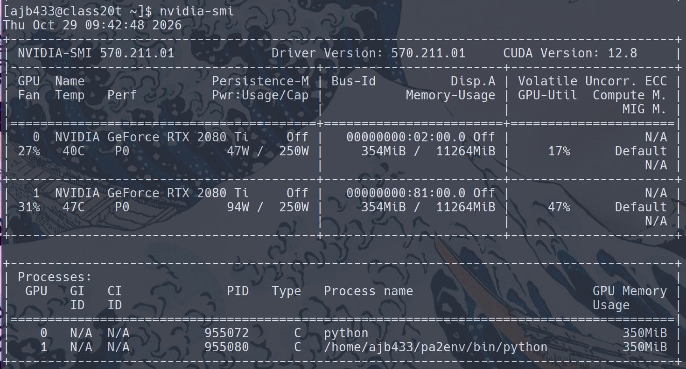

# A
File runs

# B 
I got batch sizes to work as $\{16,32,64,128\}$

# C One GPU
| Batch Size | Time (s) |
| -- | -- |
| 16 | 50.24 |
| 32 | 32.40 |
| 64 | 23.76 |
| 128 | 18.83 |

```{python}
#| echo: false

import matplotlib.pyplot as plt

x = [16,32,64,128]
y= [50.24, 32.40, 23.76, 18.83]

plt.plot(x,y)

plt.xlabel("Batch Size")
plt.ylabel("Time (s)")
plt.title("Batch Size vs Time (One GPU)")

plt.show()

```

This shows a decrease in training time as we increase the batch size

# D 2 GPUs
| Batch Size | Time (s) |
| -- | -- |
| 16 | 100.53 |
| 32 | 56.76 |
| 64 | 32.23 |
| 128 | 27.06 |

```{python}
#| echo: false

import matplotlib.pyplot as plt

x = [16,32,64,128]
y= [100.53, 56.76, 32.23, 27.06]

plt.plot(x,y)

plt.xlabel("Batch Size")
plt.ylabel("Time (s)")
plt.title("Batch Size vs Time (Two GPUs)")

plt.show()

```

This also shows a decrease in training time as we increase the batch size

# E


This shows we have 2 active GPU's because both GPU-Util are nonzero

# F & G
For both 1 and 2 GPU's as batch size increases the training time decreases. Both 1 and 2 GPU seem to follow some kind of $time=\frac{1}{batch\_size}$ pattern (might need to multiply + change the floor but its a rough pattern) but $2$ GPU seems to be roughly twice as slow as $1$ GPU. The reason this inverse relationship makes sense is because the batch size determines the number of steps, thus halving batch size means doubling the number of steps. So while the trend is the same between 1 vs 2 GPU's, 2 GPU's perform much slower. The reason this could be is because each GPU is computing on the same batch size but we need to sync the work across the GPU's at each step.Thus the reason why the 2 GPU's is slow is because of this sync at each step, as batch size increases, we have fewer steps thus fewer syncs which is why the gap between 1 vs 2 GPU decreases as batch size increases.


